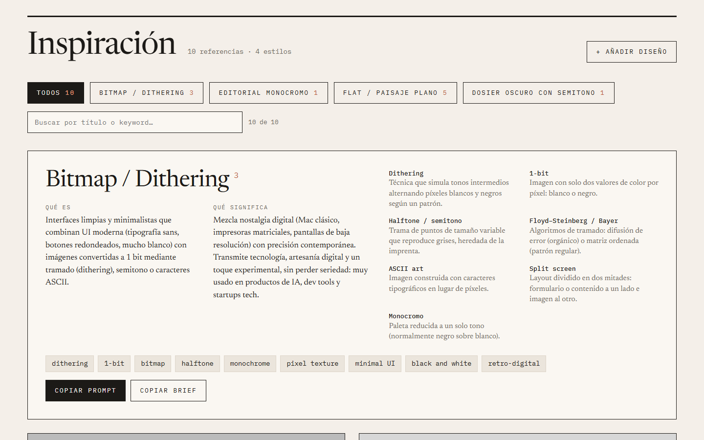
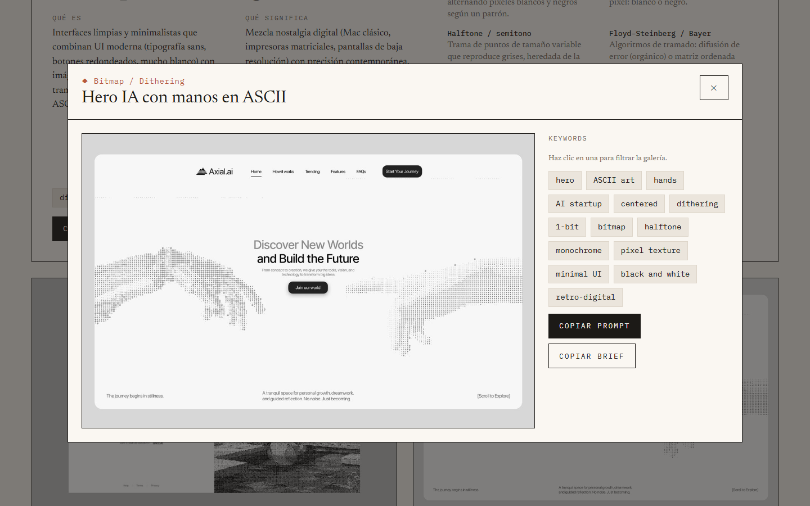
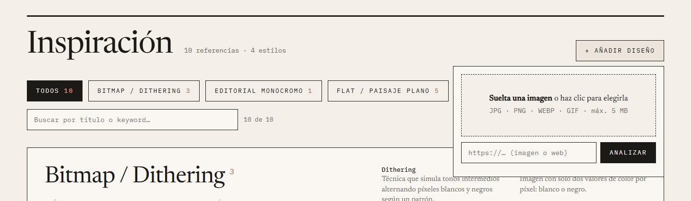

# Inspiración

Biblioteca personal de referencias de diseño, agrupadas por estilo visual. Cada estilo explica qué es, qué significa y su vocabulario. Cada referencia tiene sus keywords, y para cualquiera de ellas puedes copiar un **prompt** para generar una imagen parecida o un **brief** de diseño.

Para añadir referencias, suelta una imagen o pega una URL. Claude la analiza, la clasifica en un estilo existente (o crea uno nuevo) y escribe sus datos.



## Qué hace

- **Galería por estilos.** Cada estilo abre con su ficha: qué es, qué significa, vocabulario y keywords, con botones para copiar su prompt y su brief.
- **Detalle de cada referencia.** Al hacer clic en una imagen se abre con sus keywords y con el prompt y el brief de esa pieza concreta.
- **Filtros.** Por estilo, por texto (sin distinguir tildes) y por keyword (haz clic en una keyword del detalle). El filtro se guarda en la URL.
- **Añadir diseños con Claude.** Puedes soltar una imagen, pegar la URL de una imagen o pegar la URL de una web. Las webs se capturan con un navegador sin interfaz: hasta 4 pantallas, quitando los banners de cookies.





## Qué usa

- [Astro](https://astro.build) con el adaptador de Node, para la web y el endpoint `/api/ingest`.
- [Playwright](https://playwright.dev) para capturar las webs que pegas por URL.
- [Claude Code](https://claude.com/claude-code) en modo headless (`claude -p`) para analizar las imágenes. Usa **tu suscripción de Claude**, no hace falta API key.

Los datos viven en [`src/data/designs.json`](src/data/designs.json) y las imágenes en `public/designs/<estilo>/`.

## Ponerlo a funcionar

Necesitas Node 22.22 o superior y Claude Code instalado con tu sesión iniciada (si no lo has hecho, ejecuta `claude` una vez para iniciar sesión).

```bash
npm install
```

```bash
npx playwright install chromium
```

```bash
npm run dev
```

Abre <http://localhost:4321>.

> `astro` no está instalado de forma global, así que úsalo siempre a través de npm (`npm run dev`) o de `npx astro …`.

## Editar a mano

Todo está en [`src/data/designs.json`](src/data/designs.json). Para corregir textos, keywords o el estilo de una referencia, o para borrar una, edita ese archivo. Si borras una referencia, borra también su imagen en `public/designs/`.

## Limitaciones

- Está pensada para **uso local y personal**. Añadir diseños escribe en el JSON y en `public/`, así que solo funciona con `npm run dev` en tu máquina, no en un hosting.
- Cada análisis cuenta para el límite de uso de tu plan de Claude y tarda unos 10–25 segundos.
- Las webs que piden iniciar sesión no se pueden capturar: haz tú la captura y suéltala como imagen.
